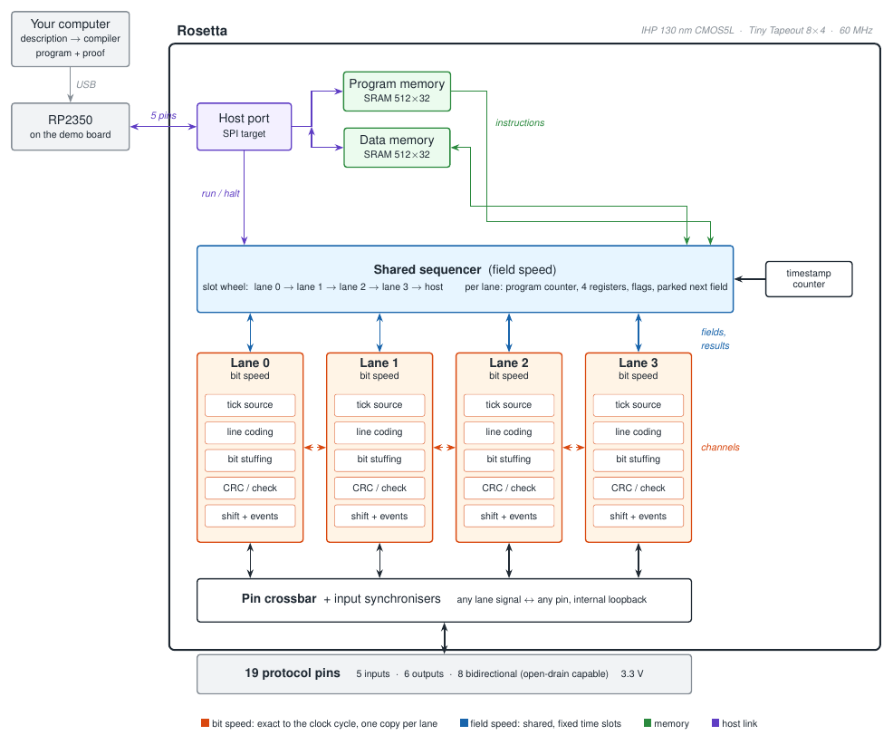

# Rosetta architecture specification

Status: **approved 13 Nov 2026**. Nothing here is implemented yet. Numbers
marked *(estimate)* have not been checked by synthesis.

## 1. What the chip is

A universal tool for digital wire protocols. A protocol is written once as a
text description. The compiler turns that description into a small program
for each role (controller, target, listener) and a formal proof that the
program obeys the protocol's rules. The demo board's RP2350 loads the program
into the chip, and the chip's hardware does the bit-level timing.

From one description the chip can:

| Ability | Meaning |
|---|---|
| Speak | Act as either side of the protocol |
| Prove | Every program carries a proof that it follows the rules |
| Listen / intercept | Decode a bus with timestamps; sit in the middle and rewrite messages |
| Stress | Break timing rules by controlled amounts to find another chip's limits |
| Translate | Move data from one protocol to another with no host involved |
| Imitate | Record an unknown device's waveform and play its part |

It is not a CPU and not an FPGA. It has no general-purpose instruction set
and no configurable logic fabric.

## 2. The central idea: two speeds of work

Every protocol has work at two speeds.

- **Bit speed.** When exactly a bit starts, how it is coded on the wire, bit
  stuffing, CRC. This must be exact to the clock cycle and can be as fast as
  one event every 3 cycles (10 Mbit Ethernet).
- **Field speed.** "Send 8 data bits, then expect an acknowledge, then branch
  on the read/write bit." This happens once per field, many cycles apart.

The chip gives bit-speed work to dedicated hardware in each **lane** and
field-speed work to one **shared sequencer** that serves the lanes in fixed
time slots. Dedicated bit hardware is what makes fast protocols possible.
Sharing the sequencer is what makes four lanes fit. Fixed slots are what make
each lane's timing independent of the others, which is something we prove.

## 3. Block diagram



Source: `figures/architecture.tex`. The same structure as text:

```
                 RP2350 host (SPI)                    24 pins
                       |                                 |
                 +-----------+                  +-----------------+
                 | host port |                  |  synchronisers  |
                 +-----------+                  |  pin crossbar   |
                   |   |   |                    +-----------------+
        +----------+   |   +---------+             |   |   |   |
        v              v             v             v   v   v   v
  +-----------+  +-----------+  +----------+   +------+ ... +------+
  |  program  |  |   data    |  | control  |   | lane |     | lane |
  |   SRAM    |  |   SRAM    |  | registers|   |  0   |     |  3   |
  |  512x32   |  |  512x32   |  +----------+   +------+     +------+
  +-----------+  +-----------+                    ^            ^
        ^              ^                          |            |
        |              |        +-----------------------------------+
        +--------------+--------|  shared sequencer (slot wheel)    |
                                |  per-lane PC, 4 registers, flags  |
                                +-----------------------------------+
                                   lane-to-lane channels, timestamp
```

## 4. Lanes (bit-speed hardware)

A lane owns up to 4 input signals and 4 output signals, mapped to physical
pins by the crossbar. Baseline is **4 lanes**; `N_LANES` is a parameter and
the final count (4 or 6) is decided by synthesis.

### 4.1 Tick source: when a bit happens

| Mode | A bit happens when | Used by |
|---|---|---|
| `BAUD` | An internal 16-bit period counter (with prescaler) expires | Any transmitter; controller side of SPI, I2C |
| `EDGE` | A chosen input has a rising, falling or either edge | Target side of SPI, I2C, JTAG, SWD, PS/2 |
| `RECOVER` | The period counter expires, and the counter re-aligns to the middle of a bit on every data edge | UART receive, USB, CAN |
| `PULSE` | An input edge arrives; the time since the last edge is compared with up to 3 thresholds to give a symbol | Manchester (Ethernet), 1-Wire, WS2812, infrared |

A programmable **launch delay** (0-255 cycles) offsets when an output
changes after its tick. This is the knob for the Stress ability (setup and
hold sweeps).

### 4.2 Line coding

- Receive: plain level, NRZI, Manchester (from `PULSE` symbols), and
  "both lines low" detection on a differential pair.
- Transmit: plain level, NRZI, Manchester (two half-bit ticks per bit),
  pulse-width coding (bit value selects a high time), open-drain (drive low
  or release), and differential (second pin is the complement).

### 4.3 Bit stuffing

A run counter inserts a bit on transmit and removes it on receive after `N`
identical bits (`N` = 1-7). Two modes cover the known cases: "after N ones
insert a zero" (USB, HDLC) and "after N equal bits insert the complement"
(CAN). A stuffing violation raises an event.

### 4.4 Check unit

A 32-bit shift register with a programmable polynomial, initial value,
bit order and final XOR. It computes any CRC up to 32 bits, one bit per
tick. Parity is the 1-bit case.

### 4.5 Shift register and field execution

A 32-bit shift register and a bit counter carry out one **field**: drive or
sample 1-32 bits, most or least significant bit first, optionally updating
the CRC and applying stuffing. A field can also be:

- **expect**: sample and compare with a value, branching on mismatch;
- **exchange**: drive and sample at once (SPI);
- **raw duration**: sample pushes the measured time between edges; drive
  holds a level for a given time. This is how Imitate records and replays a
  waveform it has no description for.

### 4.6 Events

Each lane has 4 event detectors. An event is an edge on one signal while
another signal is at a given level (I2C START and STOP), a timeout, both
lines low for K ticks (USB end-of-packet), or a stuffing violation. An event
makes the sequencer move that lane to a handler address.

## 5. Shared sequencer (field-speed)

### 5.1 The slot wheel

The wheel has 5 slots: one per lane and one for the host port. A lane may
fetch one instruction from program memory and make one data-memory access
only in its own slot. With 4 lanes at 60 MHz each lane runs up to 12 million
instructions per second, regardless of what the other lanes do.

### 5.2 Running ahead

While a lane's bit hardware is busy with a field, the sequencer keeps
executing that lane's following control instructions until it reaches the
next field, which it parks ready to start on the very next tick. Fields
therefore follow each other with no gap, provided the control instructions
between them fit in the time the current field takes. **The compiler checks
this for every program** and rejects one that cannot meet it.

### 5.3 Per-lane state

Program counter (9 bits), 4 registers of 16 bits, flags (zero, match,
CRC-good, queue empty/full, event bits), the current field and the parked
next field.

### 5.4 Instructions

32-bit words in a 512-word program memory shared by all lanes. The full
encoding goes in `docs/isa.md`. The classes are:

| Class | Examples |
|---|---|
| Field | drive / sample / expect / exchange / raw duration, 1-32 bits, with source or sink |
| Pin | set a level or release for N ticks (START, STOP, idle, both-low) |
| Mode | set tick source, coding, stuffing, CRC parameters, launch delay |
| Register | load, move, add, subtract, compare, load/store data memory |
| Flow | branch on flag, loop, wait for event or timeout, halt |
| Queue | push / pop host queue, put / get lane channel, push timestamp |

Field sources and sinks: an immediate, a register, the lane's host queue,
data memory, a lane channel, the CRC value, or discard.

## 6. Memories

Two IHP SRAM macros, `RM_IHPSG13_1P_512x32_c2_bm_bist` (0.0797 mm2 each):

- **Program memory**, 512 x 32. Written by the host while lanes are halted.
- **Data memory**, 512 x 32 (2 KB). Holds each lane's queues to and from the
  host (ring buffers with hardware pointers), packet buffers and capture
  records.

The macros are single-port with registered read data, and they cannot be
preloaded. After reset all lanes are halted until the host has loaded a
program and set a lane's run bit.

## 7. Lane channels

Four 32-bit channel registers with a valid bit. Any lane can put or get.
They carry data between lanes for Translate and Intercept, and carry
triggers ("lane 1 saw a NACK, lane 2 start capturing").

## 8. Listening and timestamps

A free-running 32-bit cycle counter gives 16.7 ns resolution at 60 MHz. A
sampled field can be sent to a capture record `{timestamp, data}` in data
memory, which the host drains. A listener program never enables an output.

## 9. Host port

An SPI target clocked by the RP2350 and sampled in the chip's clock domain
(host clock at most a few MHz). It gives register access to program memory,
data memory, per-lane control (run, halt, single-step, PC), the pin
crossbar, and queue pointers, plus an interrupt output.

## 10. Pins

| Pin | Use |
|---|---|
| `ui[0]`, `ui[1]`, `ui[2]` | Host SPI: clock, chip select, data in |
| `ui[3]`-`ui[7]` | 5 protocol inputs |
| `uo[0]`, `uo[1]` | Host SPI data out, interrupt |
| `uo[2]`-`uo[7]` | 6 protocol outputs |
| `uio[0]`-`uio[7]` | 8 bidirectional protocol pins (open-drain capable) |

All inputs pass through two-flop synchronisers. The crossbar lets any lane
input come from any input pin or from any output (internal loopback, used
for self-test on silicon), and any output pin be driven by any lane output.

## 11. Area and timing

*(estimate, to be replaced by synthesis in Phase 0)*

| Item | Area |
|---|---|
| One lane: about 480 flops and 2,500 logic cells | ~0.047 mm2 |
| Four lanes | ~0.19 mm2 |
| Sequencer, host port, crossbar, channels, timestamp | ~0.08 mm2 |
| Standard cells total, about 20K cells | ~0.27 mm2 |
| Two SRAM macros plus keep-out | ~0.19 mm2 |

Placeable area is 1.208 mm2 (`docs/area-budget.md`), so this is about 27 %
cell density outside the macros. The margin is intentional: it is there for
routing on three metal layers, for timing at 60 MHz, and possibly for two
more lanes.

Clock target is 60 MHz (16.67 ns). The longest expected paths are the
16-bit register arithmetic, the crossbar multiplexers and SRAM access; each
is registered on both sides.

## 12. Protocol coverage

| Protocol | Tick | Coding | Extras | External parts |
|---|---|---|---|---|
| UART (and MIDI, DMX512, LIN framing) | BAUD / RECOVER | level | parity | none (LIN: transceiver) |
| SPI modes 0-3 | BAUD / EDGE | level | exchange field | none |
| I2C 100 / 400 kHz | BAUD / EDGE | open-drain | START/STOP events | pull-ups |
| JTAG, SWD, PS/2, I2S | BAUD / EDGE | level, open-drain | | PS/2: pull-ups |
| CAN | RECOVER | level | stuffing, CRC-15 | transceiver |
| Low-speed USB | RECOVER | NRZI, differential | stuffing, CRC-5/16, both-low event | 1.5 k pull-up, series resistors |
| 10 Mbit Ethernet | PULSE (rx), BAUD (tx) | Manchester | CRC-32 | magnetics, comparator |
| 1-Wire, WS2812, DShot, infrared | PULSE / BAUD | pulse-width | | 1-Wire: pull-up |

Limits: the fastest pin feature must last at least 3 clock cycles (50 ns);
digital 3.3 V only; at most 19 protocol pins.

## 13. Verification obligations

Each of these is a formal proof, not a simulation (see `formal/README.md`).

1. Every block: unbounded proof of its properties, with covers.
2. Check unit equals a bit-serial reference CRC for every polynomial.
3. Stuffing: insert then remove returns the original bits, for every N.
4. Each line coding: encode then decode returns the original bits.
5. Reset: with every flop starting at an arbitrary value, all outputs are
   determined after reset, and no lane runs before the host starts it.
6. **Non-interference**: a lane's pins are identical cycle for cycle
   whatever the other lanes and the host do, unless a channel connects them.
7. Each instruction's hardware behaviour equals the instruction-set model.
8. A listener program never enables an output.
9. Every protocol program conforms to its protocol monitor for all data.
10. RTL equals the synthesized netlist.

## 14. Toolchain

Written in Python, so the same code runs on a PC and (the loader) in
MicroPython on the demo board.

- **Compiler**: description file to one program per role, a formal monitor
  with its proof job, and the gap-free schedule check from section 5.2.
- **Loader**: writes images through the host port and drains queues.

## 15. Open questions

1. Four lanes or six, decided by synthesis.
2. Whether the ones'-complement checksum (needed for answering `ping`)
   belongs in the sequencer's register arithmetic.
3. Whether sampling on both clock edges is needed for Ethernet receive
   margin, decided on the FPGA.
4. The description language itself, which is specified separately and
   needs its own approval.
